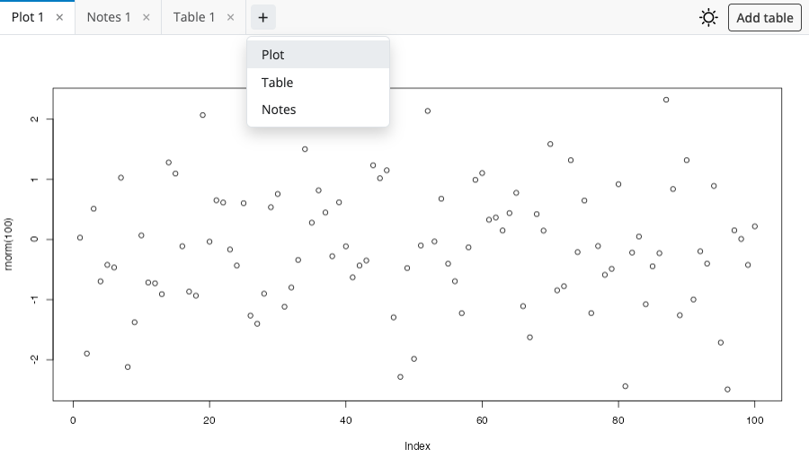
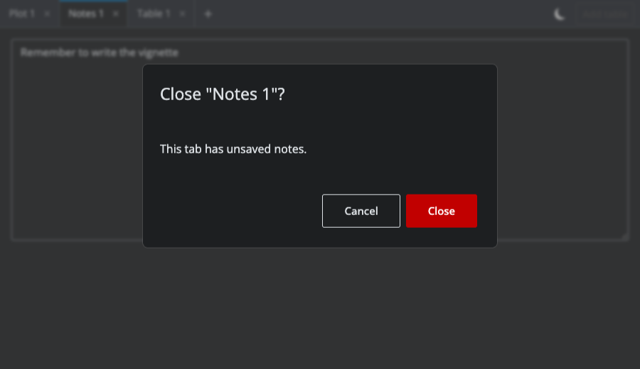

# shinytabs

Dynamic tabsets for Shiny apps. `shinytabs` provides a module whose tabs are
created and closed by the user at run time, the way editor and browser tabs
work: a "+" button opens a new tab (from a menu when there are several kinds
of tab), each tab has a close button, tabs can be dragged into a new order
and, optionally, renamed in place. Every tab hosts its own instance of a
Shiny module, and the whole thing is also controllable from the server.

It was written as the tab layer for [shinyterm](https://github.com/rundel/shinyterm),
where each tab is a terminal, but it does not know anything about terminals.

## Installation

```r
# install.packages("pak")
pak::pak("rundel/shinytabs")
```

## Usage

A tabset is a pair of module functions. `tabset_ui()` renders the tab bar and
the pane area; `tabset_server()` manages the tabs. You describe the kinds of
tab users may open (`types`) and supply a module UI function and a module
server function that build one tab:

```r
library(shiny)

ui = bslib::page_fillable(
  shinytabs::tabset_ui("tabs")
)

server = function(input, output, session) {
  shinytabs::tabset_server(
    "tabs",
    types = c("Plot" = "plot", "Notes" = "notes"),
    initial = "plot",
    renameable = TRUE,
    ui = function(id, type) {
      ns = NS(id)
      if (type == "plot") plotOutput(ns("plot"), height = "100%")
      else textAreaInput(ns("text"), NULL, rows = 12, width = "100%")
    },
    server = function(input, output, session, type) {
      if (type == "plot") output$plot = renderPlot(plot(rnorm(100)))
      list(dirty = reactive(type == "notes" && isTRUE(nzchar(input$text))))
    },
    can_close = function(handle, tab) {
      if (isolate(handle$dirty())) "This tab has unsaved notes." else TRUE
    }
  )
}

shinyApp(ui, server)
```



`ui(id, type)` receives the tab's namespaced id, like any module UI function,
and `server(input, output, session, type)` runs under
`shiny::moduleServer()` for that id, so `input$text` inside it is the text
area of that tab and nothing else. Whatever `server()` returns becomes the
tab's *handle*, which is what `can_close()` and `on_close()` receive and what
`handle(id)` returns to the app.

### Closing tabs

`can_close(handle, tab)` is consulted when the user closes a tab. Return
`TRUE` to close it, `FALSE` to keep it, or a string to ask first: the string
is shown in a modal dialog with Cancel and Close buttons. `on_close()` runs
just before any tab is removed, for cleanup such as stopping a process.



### Controlling the tabset from the server

`tabset_server()` returns a list of controls and reactives:

```r
tabs = shinytabs::tabset_server("tabs", ...)

id = tabs$add("notes", title = "Scratch")   # open a tab, returns its id
tabs$select(id)
tabs$set_title(id, "Ideas")
tabs$set_icon(id, icon("star"))             # HTML shown before the title
tabs$close(id)                              # as if the user clicked close
tabs$close(id, confirm = FALSE)             # remove without asking
tabs$handle(id)                             # the tab's server() value

tabs$tabs()       # reactive data frame: id, type, title, in display order
tabs$selected()   # reactive: id of the selected tab, or NULL
```

`types` may be a reactive, so the menu of tab kinds can change while the app
runs. `initial` lists the tabs to open at start, `max_tabs` caps the number of
open tabs, and `closeable`, `reorderable` and `renameable` switch the user
operations on and off.

### Layout and theming

With `height = NULL` (the default) the tabset is a fill item: inside
`bslib::page_fillable()` or a `bslib::card_body()` it grows to fill the
available space, and each pane is itself a fill container, so fill items in
it (plots with `height = "100%"`, other fill-aware components) follow along.
Give a `height` when the parent is not fillable.

Panes stay in the page while hidden (they are made invisible, not removed
from the layout), so their contents keep their size and state while another
tab is in front.

The tab bar reads Bootstrap 5 CSS variables when the page has them and so
follows bslib themes and `bslib::input_dark_mode()`; on other pages it uses a
neutral light palette. The `controls` argument of `tabset_ui()` places
arbitrary UI at the right end of the bar, for example that dark mode toggle
or buttons acting on the selected tab.

### Keyboard and mouse

| Action                     | How                                      |
|----------------------------|------------------------------------------|
| Select a tab               | click, or arrow keys / Home / End        |
| Open a tab                 | "+" (a menu when there are several types)|
| Close a tab                | its close button, middle click, `Delete` |
| Reorder                    | drag a tab                               |
| Rename (`renameable = TRUE`) | double click or `F2`, Enter to confirm |

A runnable demo is in `inst/examples/demo/app.R`:

```r
shiny::runApp(system.file("examples/demo", package = "shinytabs"))
```
